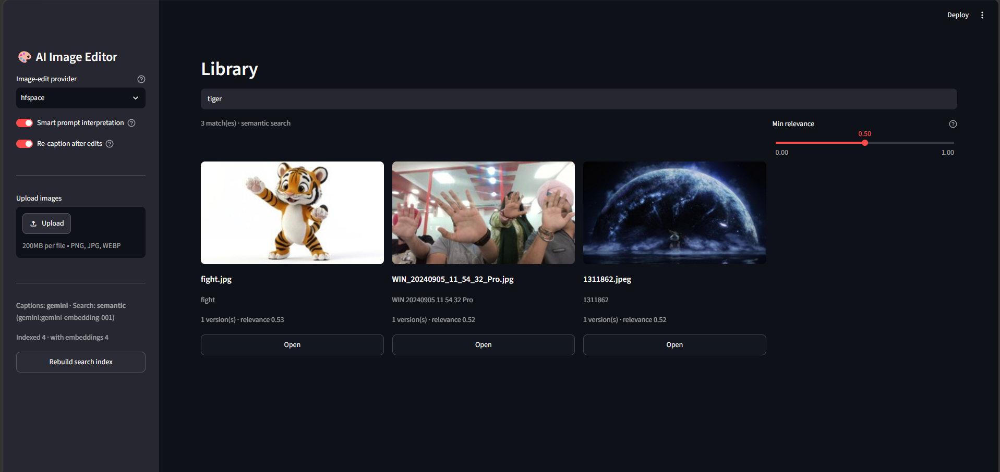
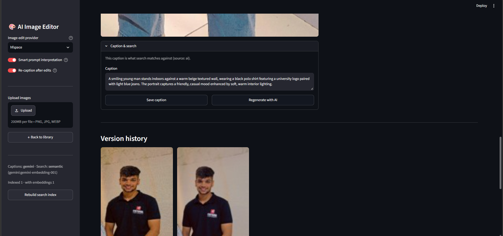
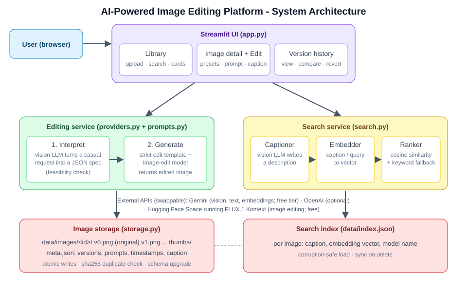
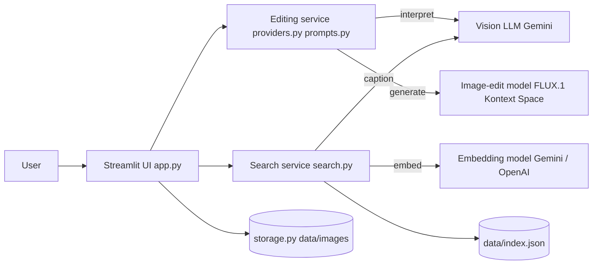

# AI-Powered Image Editing Platform

Upload photos, **search them in plain English**, edit them with natural-language instructions, and keep a
revertible version history of every change. Built with Python, Streamlit and GenAI APIs only (no custom models, no fine-tuning).

**Repository:** https://github.com/Kunala6051/ai-image-editor

## Screenshots

### Natural-language search

A query ranked against AI-generated captions using embeddings, with a relevance score on every result.

### AI captions

Each image is captioned by a vision model on upload. Captions are editable and are what search matches against.

### Editing with before / after


### Version history

Every edit is saved as a new version with a thumbnail, prompt and timestamp. Any version can be viewed, branched from or reverted to.

## Features
| Area | What it does |
|---|---|
| Library | Multi-image upload, thumbnail grid, duplicate detection, invalid-file rejection, delete with confirmation |
| **Natural-language search** | Type "sunset", "a tiger", "smiling person". Images are captioned by a vision LLM, embedded, and ranked by similarity |
| Editing | Free-text instructions plus 8 one-click presets, planned by a vision LLM and executed by an image-edit model |
| Version history | The original (v0) is never modified. Each edit stores the image, thumbnail, prompt, provider, timestamp and parent version |
| Captions | AI caption on upload and after edits; editable by hand; manual captions are never overwritten |
| Robustness | Atomic file writes, schema-versioned metadata, corrupt-file recovery, retry on rate limits, friendly API errors, and it still works with no key (keyword search + mock editor) |

## Architecture




### How search works
1. **Index time:** on upload (and after each edit) the vision LLM writes a short caption (subjects, setting, colours, mood).
   The caption plus file name is embedded with `gemini-embedding-001` and stored with the image id in `data/index.json`.
2. **Query time:** the query is embedded as a *retrieval query*, compared by cosine similarity with every stored vector, and
   blended with a keyword TF-IDF score (85% semantic / 15% keyword) so exact words still help.
3. **Fallback:** with no embedding key, search runs on keyword TF-IDF over captions. If an embedding call fails, the app
   falls back to keyword matching and shows a notice instead of crashing.
4. **Why a JSON index:** a personal library has tens to thousands of images, so brute-force cosine over a JSON file is fast,
   inspectable and dependency-free. `SearchIndex` is the one class to change if moving to Chroma or FAISS.
5. **Mixed models:** each entry records which embedding model produced it, and vectors from different models are never compared.
   *Rebuild search index* re-embeds anything out of date.

**Search quality depends on caption quality.** In testing, images that only had file-name captions (after a captioning API failure)
scored almost identically for the query "tiger" (0.53 / 0.52 / 0.52), because a name like "fight" carries no meaning.
The app therefore keeps the caption source (`ai`, `manual`, `filename`) and *Rebuild search index* re-captions file-name-only images.
The *Min relevance* slider lets you tighten or loosen matches, since embedding scores for unrelated text do not drop to zero.

### How an edit works
```
request -> [vision LLM: interpret -> JSON spec] -> [strict edit template + image model] -> new version (+ re-caption)
```
See [EXPLANATION.md](EXPLANATION.md) for the prompt design and provider choices.

## Quick start (Windows PowerShell)
```powershell
git clone https://github.com/Kunala6051/ai-image-editor.git
cd ai-image-editor
python -m venv .venv
.venv\Scripts\Activate.ps1
pip install -r requirements.txt
copy .env.example .env      # then edit .env (see below)
streamlit run app.py
```
Mac/Linux: `source .venv/bin/activate` and `cp .env.example .env`.

## Configuration (`.env`)
Put comments on their own lines, not after a value.

| Variable | Purpose |
|---|---|
| `PROVIDER` | Image editing: `hfspace` (free), `huggingface`, `gemini`, `openai`, `mock` |
| `HF_TOKEN`, `HF_SPACE` | Free Hugging Face token and the public Space used by `hfspace` (`black-forest-labs/FLUX.1-Kontext-Dev`) |
| `GEMINI_API_KEY` | Free tier. Enables AI captions, prompt planning and semantic-search embeddings |
| `GEMINI_TEXT_MODEL` | Vision/text model for captions and prompt planning |
| `GEMINI_EMBED_MODEL` | Embedding model (default `gemini-embedding-001`) |
| `OPENAI_API_KEY` | Optional alternative for captions, embeddings and editing |
| `CAPTION_PROVIDER`, `EMBED_PROVIDER` | `auto` (default), `gemini` or `openai` |
| `DATA_DIR` | Where images and the index are stored (default `data`) |

`.env` is git-ignored. Never commit keys.

## Usage guide
1. **Upload:** sidebar -> *Upload images* -> *Add to library*. Each image is captioned and indexed automatically.
2. **Search:** type in the search bar on the Library page. Use *Min relevance* to loosen or tighten matches.
3. **Open an image:** click *Open*, then use a preset or describe an edit and click *Apply edit*.
4. **Check the interpretation:** expand *How was my request interpreted?* to see the JSON spec and the final prompt.
5. **History:** scroll to *Version history*. *View* any version, *Revert* to copy an old one forward, or edit from it.
6. **Fix a caption:** *Caption & search* panel -> edit -> *Save caption*.
7. **Maintenance:** *Rebuild search index* re-captions file-name-only images and re-embeds out-of-date entries.

## Prompt experiments
| # | Prompt | Provider / model | Result | Notes |
|---|---|---|---|---|
| 1 | Shift the colour grading to cool blue tones | hfspace / FLUX.1 Kontext | Worked: whole image turned blue | Strong effect; the background changed as well |
| 2 | Remove the background and replace it with a clean plain white background, keeping the main subject untouched. (preset) | hfspace / FLUX.1 Kontext | Worked: background replaced with white, subject kept | Clean cut-out on a portrait with a busy plant background |
| 3 | Convert the photo to a high-quality black and white image with rich contrast. (preset) | hfspace / FLUX.1 Kontext | Worked: edit applied, new version saved | Preset wording asks for a colour change only |
| 4 | Give the photo a vintage 35mm film look: faded blacks, soft grain, slightly muted colours. (preset) | hfspace / FLUX.1 Kontext | Worked: edit applied, new version saved | Style prompt with several visual cues |

## Project structure
```
app.py            Streamlit UI: library + search, detail/edit, history
providers.py      Edit and caption provider adapters, error handling
prompts.py        Prompt templates and presets
search.py         Captioner, embedders, JSON search index, ranking
storage.py        Local storage, versioning, validation, atomic writes
tests/            Unit tests (storage, versioning, search)
docs/             Architecture diagram and screenshots
EXPLANATION.md    API selection and prompt design
```

## Tests
```powershell
pip install pytest
python -m pytest -q
```
11 tests cover storage, versioning, duplicate detection, index persistence and corruption recovery, and keyword and semantic ranking.
The search tests use a deterministic fake embedder, so they run offline with no API key.

## Troubleshooting
| Symptom | Cause and fix |
|---|---|
| 429 `RESOURCE_EXHAUSTED`, `limit: 0` on an image model | Gemini image output has no free-tier quota. Use `PROVIDER=hfspace` or enable billing |
| `Captions: openai` and a 401 error | An old `OPENAI_API_KEY` is set in the system. The app loads `.env` with override, so keep that line empty or valid |
| 404 `NOT_FOUND` for a Gemini model | The model was retired. Set `GEMINI_TEXT_MODEL` to a current model your key lists |
| 503 `UNAVAILABLE` while captioning | Google is overloaded. The app retries, then keeps a file-name caption; click *Rebuild search index* later |
| "requested GPU duration is larger than the maximum" | The chosen Space asks for more GPU time than a free account allows. Use `black-forest-labs/FLUX.1-Kontext-Dev` |
| `api_name` error mentioning `# ...` | An inline comment ended up inside a `.env` value. Put comments on separate lines |

## Limitations
- Free GPU and API quotas can run out for the day. Edits then fail with a clear message and the rest of the app keeps working
- Free hosted editing models are less precise than paid ones, and results vary between runs
- Storage is local and single-user, and the JSON index is not intended for 100k+ images
- The app runs locally and is not deployed

## Roadmap
Cloud storage, Chroma or FAISS backend for large libraries, batch edits, mask-based editing, hosted deployment.