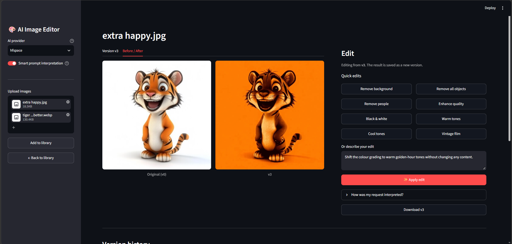
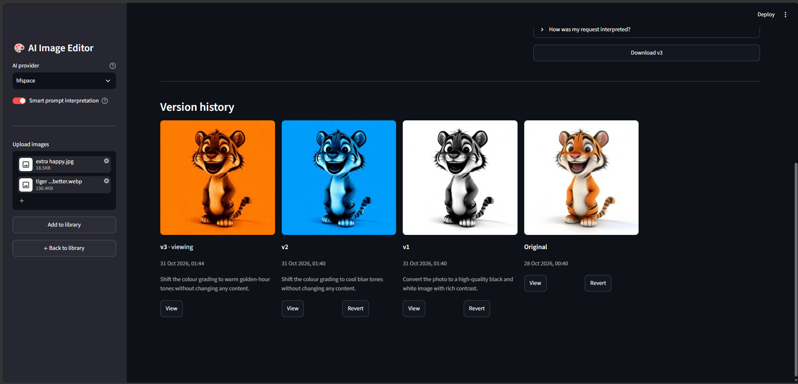

# AI-Powered Image Editing Platform

GITHUB: https://github.com/Kunala6051/ai-image-editor

Edit images with plain-English instructions ("remove the person on the left", "make the background blue"),
and keep a full, revertible version history of every edit. Built with Python, Streamlit and GenAI APIs only
(no custom models, no fine-tuning).

**Status:** Week 2 - AI editing + version history. Library search and captioning come next.

## Screenshots
| Edit view (before / after) | Version history |
|---|---|
|  |  |

## Features
- Upload images into a local library and open any of them for editing
- Natural-language editing plus one-click presets (remove background, remove people, B&W, warm/cool tones...)
- Two-stage prompt pipeline: a vision LLM turns a casual request into a structured edit spec, then a strict template drives the image model
- Non-destructive version history: original (v0) is never touched; every edit stores image, thumbnail, prompt, provider, timestamp and parent version
- View, compare (before/after), download, branch from, or revert to any version
- Swappable providers: Hugging Face Space (free), Hugging Face Inference, Gemini, OpenAI, or a mock filter provider for offline demos

## Quick start (Windows PowerShell)
```powershell
git clone https://github.com/<your-username>/ai-image-editor.git
cd ai-image-editor
python -m venv .venv
.venv\Scripts\Activate.ps1
pip install -r requirements.txt
copy .env.example .env      # then edit .env
streamlit run app.py
```
Mac/Linux: use `source .venv/bin/activate` and `cp .env.example .env`.

## Configuration (`.env`)
| Variable | Purpose |
|---|---|
| `PROVIDER` | `hfspace` (free), `huggingface`, `gemini`, `openai`, or `mock` |
| `HF_TOKEN` | Free Hugging Face token (enable "Make calls to Inference Providers") |
| `HF_SPACE` | Public Gradio Space used by `hfspace`, e.g. `black-forest-labs/FLUX.1-Kontext-Dev` |
| `GEMINI_API_KEY` | Optional and free for text: enables the prompt-planning step and captions |
| `OPENAI_API_KEY` | Only for the OpenAI provider |

Never commit `.env`; it is git-ignored.

## Providers and why
| Provider | Role | Notes |
|---|---|---|
| `hfspace` | Image edit (default free route) | Calls a public FLUX.1 Kontext Space; uses free ZeroGPU quota |
| `huggingface` | Image edit | Inference Providers; free monthly credits are small |
| `gemini` | Planner + captions (free text model); image edit (`gemini-2.5-flash-image`) | Image output has no free-tier quota (API returns 429, `limit: 0`) |
| `openai` | Planner + image edit (`gpt-image-1`) | Paid |
| `mock` | UI / version-history development | Simple PIL filters, no network |

See [EXPLANATION.md](EXPLANATION.md) for the full reasoning.

## How an edit flows
```
user request --> [vision LLM: interpret] --> structured spec (JSON)
                                   |
                                   v
                      [edit template + image model] --> edited image
                                   |
                                   v
              [storage: save version + thumbnail + metadata]
```

## Prompt experiments
Fill in from your own runs.

| # | Prompt | Provider / model | Result | Notes / what I changed |
|---|---|---|---|---|
| 1 | Shift the colour grading to cool blue tones | hfspace / FLUX.1 Kontext | Worked: whole image turned blue | Strong effect; background also changed |
| 2 | Remove the background and replace it with a clean plain white background, keeping the main subject untouched. (preset: Remove background) | hfspace / FLUX.1 Kontext | Worked: edit applied, new version saved | One-click preset; goes through the same interpret → edit pipeline as typed prompts |
| 3 | Convert the photo to a high-quality black and white image with rich contrast. (preset: Black & white) | hfspace / FLUX.1 Kontext | Worked: edit applied, new version saved | Preset wording tells the model to change colour only, not content |
| 4 | Give the photo a vintage 35mm film look: faded blacks, soft grain, slightly muted colours. (preset: Vintage film) | hfspace / FLUX.1 Kontext | Worked: edit applied, new version saved | Style prompt with several visual cues (fade, grain, muted colour) |

## Project structure
```
app.py            Streamlit UI (library, edit view, history)
providers.py      Provider adapters + error handling
prompts.py        Prompt templates and presets
storage.py        Local storage and version tracking
tests/            Unit tests for storage and versioning
docs/screenshots  Images used in this README
EXPLANATION.md    API selection and prompt design write-up
```

## Run the tests
```powershell
pip install pytest
python -m pytest -q
```

## Limitations
- Free hosted models are slower and less precise than paid ones; results vary between runs
- Free GPU quotas can run out for the day
- Storage is local files (not suitable for multi-user deployment yet)

## Roadmap
- Week 3: image captioning, embeddings, natural-language library search
- Cloud storage and deployment (Streamlit Cloud / Hugging Face Spaces)